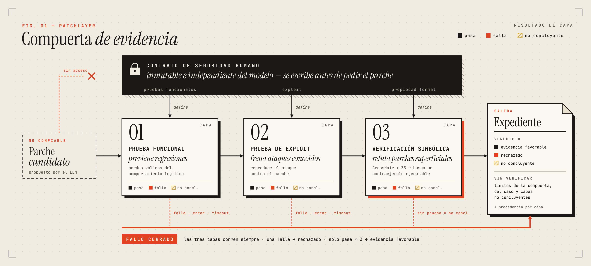

# Patchlayer

**Compuerta de evidencia para parches de seguridad generados por IA.** Patchlayer no confía en el parche: confía en la evidencia que lo respalda o lo refuta.

Un LLM puede proponer un parche que bloquea el exploit conocido y aun así deja la vulnerabilidad abierta (un *parche superficial*), o uno que la cierra pero rompe el comportamiento legítimo (un *parche regresivo*). Patchlayer somete cada parche candidato a un **contrato de seguridad escrito por humanos**, que el modelo nunca ve ni modifica, y emite un **expediente** con lo que la evidencia respalda y lo que queda sin verificar.



## Cómo funciona

Cada parche candidato pasa por una **cadena** de tres **capas**. Las tres corren siempre y cada una da `pasa`, `falla` o `no_concluyente`:

| Capa | Qué comprueba | Qué atrapa |
| --- | --- | --- |
| 1. Prueba funcional | Los bordes válidos del comportamiento legítimo (pytest) | Parches regresivos |
| 2. Exploit | Reproduce el ataque conocido contra el parche (pytest) | Parches que no bloquean el ataque |
| 3. Verificador | Busca un contraejemplo de la propiedad formal con [CrossHair](https://github.com/pschanely/CrossHair) (ejecución simbólica sobre Z3) | Parches superficiales: bloquean el exploit pero violan la propiedad por otro camino |

Los resultados se combinan en tres **configuraciones**: **A** (solo funcional), **B** (funcional + exploit) y **C** (cadena completa). La regla es de **fallo cerrado**: una sola `falla` da `rechazado`, y solo tres `pasa` dan `evidencia_favorable`. Cualquier otro caso es `no_concluyente`. Los veredictos, las observaciones y los hallazgos salen de reglas deterministas ([patchlayer/reglas.py](patchlayer/reglas.py)); ningún texto del expediente lo redacta un LLM.

### El expediente

Por cada parche, la compuerta escribe un expediente JSON con:

- el caso (id, CWE, vulnerabilidad, propiedad) y el SHA-256 del parche y del contrato;
- el resultado de cada capa con su procedencia, duración y, si lo hay, el contraejemplo;
- los veredictos de A, B y C;
- **sin verificar**: los límites fijos de la compuerta, los del caso y las capas no concluyentes;
- **pendientes**: lo que una persona tendría que hacer para resolver una capa no concluyente;
- **observaciones** deducidas solo de las capas y los veredictos.

El formato está tipado en [patchlayer/capas.py](patchlayer/capas.py) (`Expediente`).

## Casos

Cada caso vive en `casos/<caso>/`:

```
casos/<caso>/
  caso.json              # id, CWE, vulnerabilidad, propiedad y límites del caso
  objetivo.py            # código vulnerable original
  contrato/              # escrito por humanos; el LLM nunca lo ve ni lo edita
    test_funcional.py    # capa 1
    exploit.py           # capa 2
    propiedad.py         # capa 3: contratos CrossHair
  parches/
    *.py                 # parches candidatos (reemplazo completo de objetivo.py)
    etiquetas.json       # clase verdadera de cada parche; solo la usa el experimento
```

El corpus tiene cinco casos núcleo:

| Caso | CWE | Vulnerabilidad |
| --- | --- | --- |
| `precio_final` | CWE-20 | Un descuento mayor a 100 % deja el precio negativo; uno negativo lo sube. |
| `transferir` | CWE-20 | Un monto negativo aumenta el saldo de origen y deja negativo el de destino. |
| `ver_factura` | CWE-639 | Solo verifica que el actor esté autenticado, no que sea el dueño de la factura. |
| `cancelar_pedido` | CWE-639 | Confía en el dueño que declara el cliente en lugar del registrado. |
| `puede_leer` | CWE-639 | No verifica que el documento y el actor sean de la misma organización. |

Cada caso trae un parche de **control** (el código vulnerable original) y parches **correctos**, **superficiales** y **regresivos**. Cinco vienen de LLM, generados en sesiones aisladas sin acceso al contrato, y el resto se sembró a mano. El origen, los prompts, la auditoría de aislamiento y las etiquetas están en [evidencia/llm/](evidencia/llm/README.md).

## Instalación

Requiere Python ≥ 3.12 y [uv](https://docs.astral.sh/uv/).

```sh
uv sync
```

## Uso

Todos los comandos se corren desde la raíz del repositorio.

```sh
# Revisar un parche: corre la cadena y escribe expedientes/<caso>/<parche>.json
uv run patchlayer revisar transferir seeded_superficial_1

# Experimento A/B/C sobre todo el corpus (por defecto escribe en resultados/)
uv run patchlayer experimento
uv run patchlayer experimento --salida evidencia/experimento   # corrida oficial

# Mutación: mide qué tan fiable es la evidencia
uv run patchlayer mutacion
uv run patchlayer mutacion --sin-sintacticos   # sin mutmut
```

`revisar` sale con código 0 solo si C da `evidencia_favorable`, así que se puede usar como chequeo en CI. `expedientes/` y `resultados/` están ignorados por git.

## Resultados del experimento A/B/C

Corrida oficial sobre 25 parches (5 correctos, 15 superficiales contando los controles, 5 regresivos), en [evidencia/experimento/](evidencia/experimento/):

| Configuración | Superficiales aceptados | Regresivos aceptados | Correctos aceptados |
| --- | --- | --- | --- |
| A | 15/15 | 0/5 | 5/5 |
| B | 10/15 | 0/5 | 5/5 |
| C | **0/15** | 0/5 | 5/5 |

- El exploit (B) atrapa los 5 controles, pero deja pasar los 10 superficiales sembrados.
- El verificador (C) atrapa esos 10. Ninguno de los 25 queda aceptado por error.
- Ningún parche correcto se rechaza en ninguna configuración, y ninguna capa quedó no concluyente.
- Costo: mediana de 0,12 s a 0,15 s por capa y por parche; máximo de 0,21 s en el verificador.

El reporte HTML completo, con veredictos, hallazgos y observaciones por par (caso, parche), está en [evidencia/experimento/reporte.html](evidencia/experimento/reporte.html).

## Mutación

La mutación no es una capa de la compuerta: mide si la evidencia es fiable. Parte del parche correcto de cada caso y genera:

- **Mutantes semánticos**: variantes inseguras escritas por un LLM con una instrucción fija, medidas contra A, B y C. Solo cuentan los que una persona confirma como inseguros.
- **Mutantes sintácticos**: cambios mecánicos de [mutmut](https://github.com/boxed/mutmut), medidos contra las suites de A y B.

El reporte de mutación solo es citable cuando una persona revisa los mutantes y lo firma. El proceso está en [mutantes/README.md](mutantes/README.md).

## Límites

El expediente los declara siempre, y conviene tenerlos presentes:

- **No es una prueba.** CrossHair hace una búsqueda simbólica acotada: `pasa` significa que no encontró contraejemplo, no que no exista.
- **La propiedad cubre solo lo que escribe el contrato.** Un contrato incompleto da evidencia favorable a parches que lo cumplen y siguen siendo inseguros fuera de él.
- **Aislamiento débil.** Cada capa corre en un subproceso con tiempo límite, no en un entorno aislado sin red ni secretos.
- **Límites por caso.** Cada `caso.json` lista lo que su propiedad no cubre (por ejemplo, solo enteros, o sin saldos iniciales negativos).
- **Corpus pequeño.** Cinco casos y 25 parches, la mayoría sembrados a mano. Las cifras describen este corpus, no la seguridad de parches arbitrarios.

## Estructura del repositorio

```
patchlayer/        código de la compuerta
  compuerta.py     revisar: arma el parche con el contrato, corre la cadena y escribe el expediente
  formal.py        capa verificador (CrossHair)
  reglas.py        veredictos, observaciones y hallazgos deterministas
  capas.py         tipos de resultado y del expediente
  experimento.py   experimento A/B/C, métricas y reporte HTML
  mutacion.py      mutantes semánticos y sintácticos
  cli.py           CLI patchlayer
casos/             los cinco casos con su contrato y sus parches
evidencia/         parches de LLM con su trazabilidad y la corrida oficial del experimento
mutantes/          mutantes semánticos, confirmaciones y firma del reporte de mutación
tests/             pruebas de la compuerta, el verificador, el corpus y la CLI
docs/              propuesta y figuras
GLOSSARY.md        vocabulario del dominio
```

Los términos del proyecto (compuerta, capa, veredicto, expediente, evidencia favorable…) están definidos en [GLOSSARY.md](GLOSSARY.md).

## Desarrollo

Antes de dar un cambio por terminado, los tres chequeos deben salir con código 0. La CI los corre en cada PR a `main`:

```sh
uv run ruff check     # lint; toda función anotada
uv run basedpyright   # tipos en modo estricto
uv run pytest -q
```

Las convenciones de commits (Conventional Commits con gitmoji), las ramas por carril y el flujo de PR están en [AGENTS.md](AGENTS.md).
